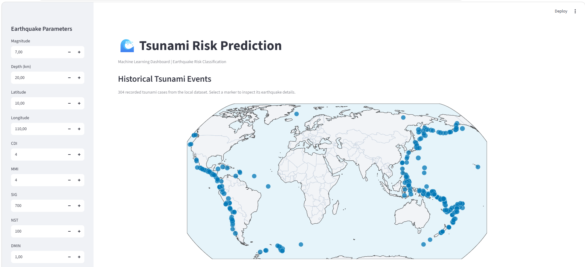
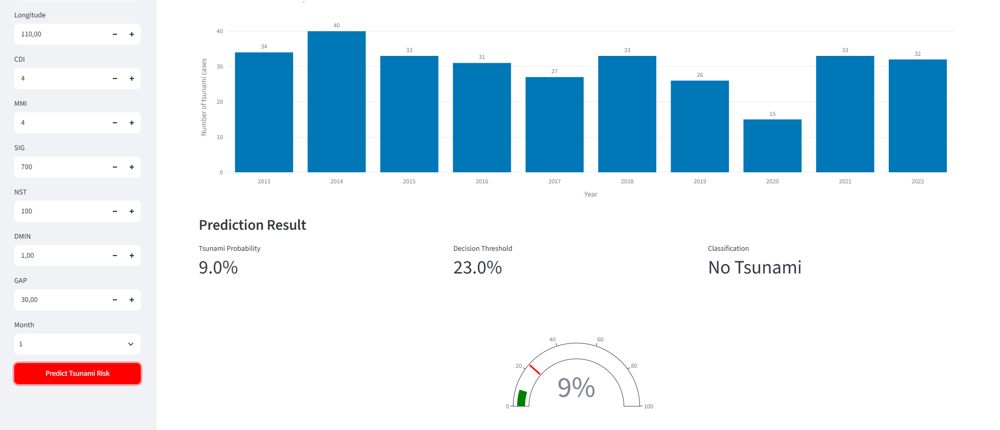

# Predicting Tsunamis using Machine Learning

## Project Overview
This project focuses on predicting whether an earthquake will generate a tsunami using seismic and geospatial features.  
The task is formulated as a **binary classification problem**, aiming to support early-warning decision systems with data-driven models.

## Dataset
The dataset contains historical earthquake events with:
- Seismic features (magnitude, depth, intensity)
- Geographic coordinates (latitude, longitude)
- Event significance and impact indicators
- Binary target label: tsunami (0/1)

Data preprocessing includes:
- Missing value handling
- Feature scaling
- Train/validation/test splitting
Link dataset: "https://www.kaggle.com/datasets/ahmeduzaki/global-earthquake-tsunami-risk-assessment-dataset"

## Run the Dashboard

Use 64-bit Python 3.13 and create a clean environment. The model artifact must
be trained and loaded with the same scikit-learn version:

```powershell
py -3.13 -m venv .venv313
.\.venv313\Scripts\python.exe -m pip install --upgrade pip
.\.venv313\Scripts\python.exe -m pip install -r requirements.txt
```

## Train the Model Locally

Place `earthquake_data_tsunami.csv` in the project root, open
`models/predicting-tsunamis.ipynb` in VS Code, select the `.venv313` kernel,
and run all cells from top to bottom. This retraining step is required because
the checked-in model was created with an incompatible scikit-learn version.
The notebook resolves the dataset from the project root and writes
`models/rf_pipeline.joblib` and `models/threshold.json` there, including the
scikit-learn version used to train the model. Start the dashboard with the same
environment:

```powershell
.\.venv313\Scripts\streamlit.exe run app.py
```

The custom preprocessing transformers are defined in `feature_generator.py`
so the saved pipeline can resolve them when loaded by Streamlit.

## Exploratory Data Analysis (EDA)
Key analyses include:
- Statistical distribution of seismic features
- Correlation analysis between variables
- Geographic clustering of tsunami-prone regions
- Magnitude–depth interaction patterns

Insights from EDA guide feature engineering and model selection.

## Feature Engineering

### 1. Physics-Informed Seismic Features
- Energy-related transformations of magnitude
- Depth-weighted intensity measures

### 2. Spherical Earth Representation
- Conversion of latitude/longitude into 3D Cartesian coordinates
- Preserves spatial relationships on Earth’s surface

### 3. Adaptive Spherical RBF Encoding
- Radial Basis Functions to model regional seismic patterns
- Helps capture localized tsunami risk zones

## Models Evaluated
Multiple classifiers were compared under the same experimental setup:
- Logistic Regression
- Decision tree
- Random Forest
- Gradient Boosting
- XGBoost
- AdaBoost
- LightGBM
- SVM

Evaluation metrics:
- Accuracy
- F1-score, F2-score
- Confusion Matrix

## Hyperparameter Optimization
- Grid Search on Random Forest model.
- Optimization focused on F2-Score.

## Feature Selection & Interpretability

### Feature Importance
- Mean Decrease in Impurity (MDI)
- SHAP (SHapley Additive exPlanations)

### Explainability Goals
- Identify key seismic and spatial drivers of tsunami risk
- Provide both global and local explanations

Low-impact features were pruned to reduce model complexity.

## Decision Threshold Optimization
Instead of using the default 0.5 threshold:
- Threshold tuned to maximize F1-score
- Better balance between false positives and false negatives

## Final Evaluation on Test Set
Final model evaluated using:
- Accuracy: 0.95
- F2-score: 0.96
- Precision: 0.9
- Recall: 0.98

Results show improved recall for tsunami events while maintaining acceptable precision.
## Web dashboard
 